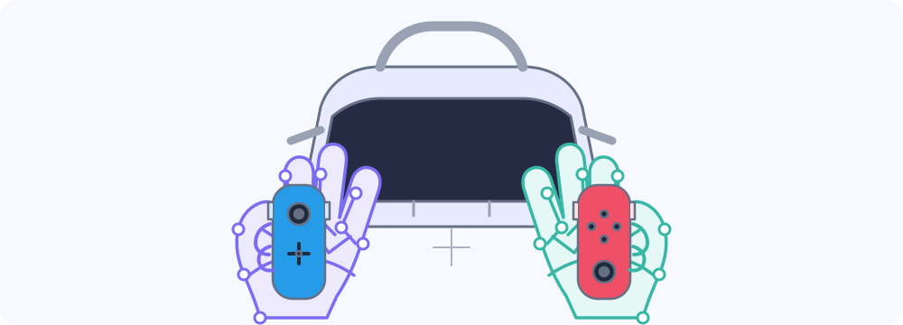
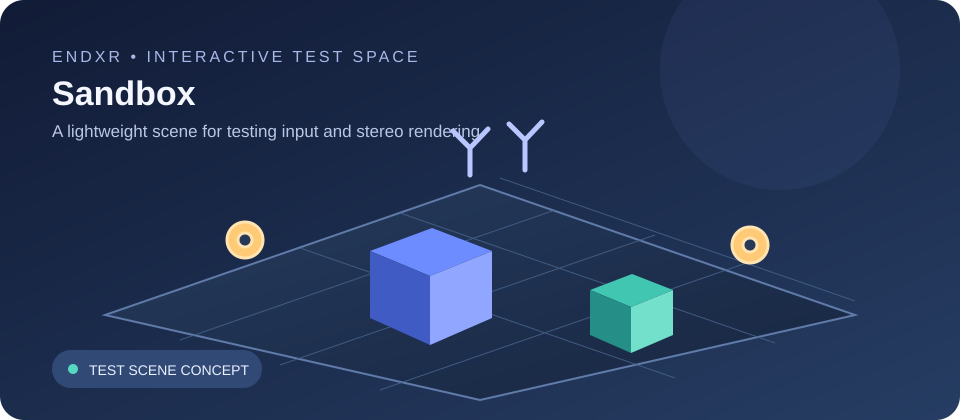
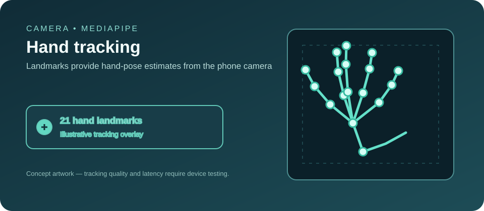
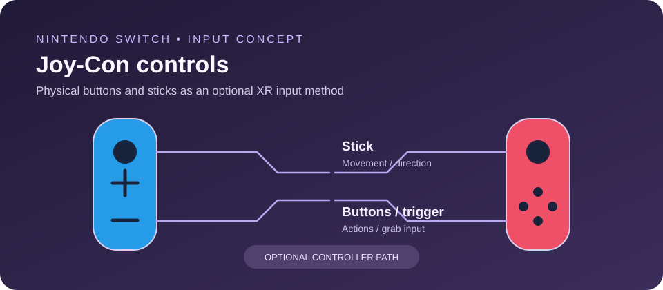
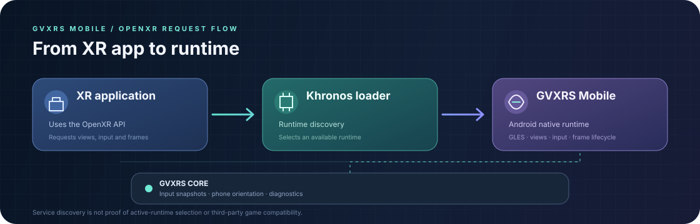

# QuestPhoneXR

**QuestPhoneXR is an Android XR project that explores what a regular smartphone can do in virtual reality.**

<p align="center">
  
</p>

The long-term idea is simple: use an Android phone as the XR device, run lightweight VR experiences directly on it, and build an OpenXR runtime that can gradually support more demanding applications.

The project is called **EndXR** on the Android runtime side. A separate PC streaming component, planned as **EndVR**, is a future direction—not a feature that is already available.

> **Current stage:** an early, actively developed prototype. The native runtime, Sandbox, input bridge and Android test pipeline are in place, but real third-party game compatibility has not yet been demonstrated on a physical phone.

## What QuestPhoneXR is working towards

- **Phone-based VR:** use a smartphone viewer such as VR Shinecon to view a stereoscopic scene.
- **Hand tracking:** use the phone camera and MediaPipe to detect hands and gestures.
- **OpenXR:** provide an Android runtime foundation through the native EndXR implementation.
- **Game experiments:** investigate which Android and Quest-oriented applications can be adapted, and which require deeper changes.
- **PC streaming (future):** explore a separate EndVR system for streaming PC VR to the phone, with Linux as a first-class platform.

A Meta Quest headset is not required for the phone-based development path.

## What works today

The repository contains several working foundations:

| Area | Current state |
| --- | --- |
| Android application and game library | Implemented |
| Sandbox and in-process stereo rendering | Implemented and covered by CI tests |
| CameraX and MediaPipe hand tracking | Implemented; physical-device performance still needs testing |
| Native EndXR OpenXR bootstrap | Implemented and covered by native tests |
| OpenXR Actions and input API | Partial implementation |
| Separate-process runtime discovery probe | Implemented and exercised in Android emulator CI |
| Cross-process input snapshots | Implemented; real external-game input still needs device validation |
| Hand-pose estimates | Available as estimates, not tracked 6DoF controller poses |
| Runtime selection through Android RuntimeBroker | Not yet verified on the target phone |
| Third-party Quest game compatibility | Not yet demonstrated |

See [the EndXR runtime status](docs/ENDXR_RUNTIME.md) for the detailed implementation notes and limitations.

## Visual overview

These illustrations show the main systems being explored in QuestPhoneXR. They are conceptual diagrams, not screenshots of a finished runtime or proof of device compatibility.

<p align="center">
  
</p>

<p align="center">
  
</p>

<p align="center">
  
</p>

<p align="center">
  
</p>

## Important: what this does not mean

QuestPhoneXR is **not yet a universal Quest APK launcher**.

An APK appearing in the library does not mean it can run in VR. Some applications are ordinary Android apps, some can be adapted or ported, and some depend on Meta/Oculus services or runtime features that this project does not provide.

The APK analyzer performs static inspection: it looks for engine and XR-related markers, checks device requirements, and suggests a likely route. It does not execute the APK or prove that the game is compatible.

Likewise, the current hand-pose output is an estimate derived from the camera image and MediaPipe landmarks. It must not be confused with calibrated, tracked 6DoF controllers or the OpenXR hand-tracking extension.

## How the project is organized

- **Android app:** the user interface, library, Sandbox, camera and device diagnostics.
- **EndXR native runtime:** the Android OpenXR runtime implementation and JNI/native code.
- **External client probe:** a separate Android package used to test runtime discovery and the official Khronos OpenXR loader outside the main app process.
- **PC tracking bridge:** an experimental path for sending head-orientation and hand-tracking telemetry to a PC. It is not a video streamer or a SteamVR driver.
- **EndVR:** a planned, separate PC VR streaming project. Video transport, a SteamVR driver and Linux/Windows host applications are not implemented yet.

## Try the project

### Requirements

- Android Studio.
- JDK 17.
- Android SDK 36.
- Android NDK and CMake (the CI workflow currently uses NDK 27.2.12479018 and CMake 3.22.1).
- A physical Android phone for camera, sensor, hand-tracking and runtime-selection tests.

Open the repository root in Android Studio and sync the Gradle project. GitHub Actions provisions Gradle 8.13 for CI; the repository does not currently include the binary Gradle wrapper JAR.

### Build locally

With Gradle 8.13 installed and the Android SDK/NDK configured:

```bash
gradle --no-daemon :app:assembleDebug
gradle --no-daemon :runtime-client-probe:assembleDebug
```

The debug APKs are produced under each module's `build/outputs/apk/debug/` directory.

## Automated tests and downloads

GitHub Actions runs automatically on pushes and pull requests targeting `main`. The workflow:

1. Runs the native EndXR core and OpenXR bootstrap tests.
2. Runs Kotlin/JVM unit tests.
3. Builds the main app and the separate external-client probe APK.
4. Checks that required native libraries and the MediaPipe model are packaged.
5. Starts an Android 15 emulator and runs navigation, Sandbox and external-loader smoke tests.
6. Uploads APKs, screenshots, logs and test reports as workflow artifacts.

You do not need to press **Run workflow** for the normal build and test pipeline: pushing a commit to `main` starts it automatically. A manual workflow-dispatch option also exists.

**Important:** an emulator test is not a substitute for testing the physical phone. The emulator cannot confirm camera tracking quality, thermal behaviour, sustained frame rate, vendor RuntimeBroker availability or compatibility with a real XR game.

To download a build, open [GitHub Actions](https://github.com/Noyclic/QuestPhoneXr/actions), select a successful run, and download the APK artifacts near the bottom of the run page. Artifacts are temporary and expire according to the retention period configured in the workflow.

## Next milestones

1. Verify EndXR selection through a real Android RuntimeBroker on the target phone.
2. Test an external OpenXR client through instance creation, session creation, swapchain operations and frame submission.
3. Validate camera service stability, hand-pose quality and input latency on physical hardware.
4. Improve IPC access control and keep the runtime documentation aligned with the implementation.
5. Continue EndXR interoperability work and test applications individually.
6. Start EndVR as a separate PC streaming system, prioritizing Linux before Windows.

## Documentation

- [EndXR runtime: implementation and limitations](docs/ENDXR_RUNTIME.md)
- [Project architecture](docs/ARCHITECTURE.md)
- [External OpenXR loader test guide](docs/OPENXR_LOADER_VALIDATION.md)
- [EndXR cross-process input IPC security](docs/IPC_SECURITY.md)
- [Device compatibility diagnostics](docs/DEVICE_COMPATIBILITY.md)

## Licensing

QuestPhoneXR project source is licensed under the MIT License unless a file or third-party dependency specifies otherwise. Third-party libraries, SDKs, game code, assets and models retain their own licenses.
