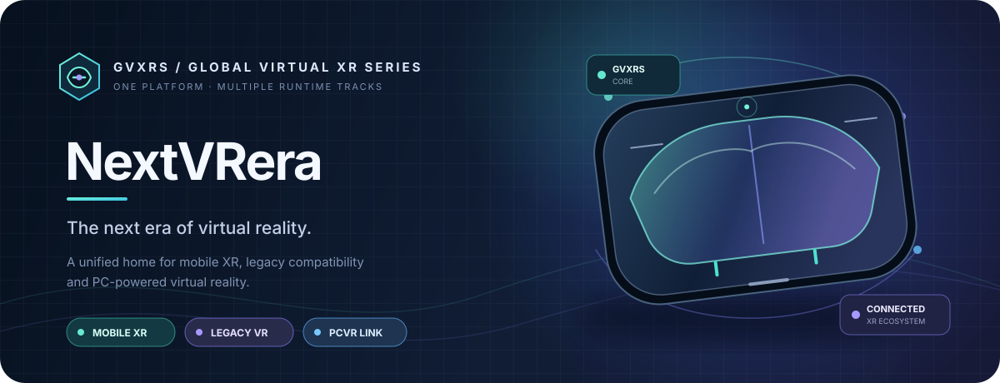
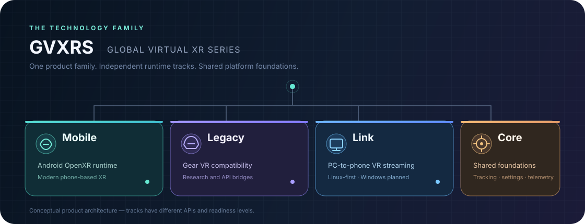

# NextVRera

**NextVRera is the main Android application of GVXRS — Global Virtual XR Series.** GVXRS is an experimental family of phone-based XR, legacy VR compatibility and PCVR streaming technologies.

<p align="center">
  
</p>

The long-term idea is to make one coherent VR platform from several independent runtime tracks. A regular Android phone can act as a lightweight XR device, run compatible OpenXR experiences, explore legacy VR compatibility and connect to a PC for streamed VR.

## GVXRS runtime family

- **GVXRS Mobile** — the Android OpenXR runtime track. Its current native implementation still contains legacy EndXR source, service and library identifiers for compatibility.
- **GVXRS Legacy** — the Gear VR compatibility track. It is isolated from the modern OpenXR runtime and currently focuses on identifying legacy dependencies and documenting what a future compatibility layer would need.
- **GVXRS Link** — the PC-to-phone VR streaming track, with Linux treated as a first-class host platform and Windows also planned.
- **GVXRS Core** — shared platform foundations such as tracking data models, diagnostics, capabilities and common settings. This is an architectural grouping, not a claim that every shared service is already complete.

The app is named **NextVRera**. Its Android application ID and Kotlin package remain `com.noyclic.questphonexr` for now; changing those technical identifiers is a separate migration because they are also used by runtime discovery, IPC permissions and installed-app identity.

## What the project is working towards

- **Phone-based VR:** use a smartphone viewer such as VR Shinecon for stereoscopic viewing.
- **Hand tracking:** use the phone camera and MediaPipe to estimate hands and gestures. Camera use stays optional and starts only after the user enables it.
- **OpenXR:** provide an Android runtime foundation through GVXRS Mobile.
- **Legacy compatibility research:** inspect Gear VR-era APK dependencies without claiming that those applications already run.
- **PC streaming:** develop GVXRS Link as a separate host/client path, prioritizing Linux and keeping Windows in scope.

A Meta Quest headset is not required for the phone-based development path.

## What works today

| Area | Current state |
| --- | --- |
| Android application and game library | Implemented |
| Sandbox and in-process stereo rendering | Implemented and covered by CI tests |
| CameraX and MediaPipe hand tracking | Implemented; physical-device performance still needs testing |
| Native OpenXR bootstrap | Implemented and covered by native tests |
| OpenXR Actions and input API | Partial implementation |
| Separate-process runtime discovery probe | Implemented and exercised in Android emulator CI |
| Cross-process input snapshots | Implemented; package-scoped read-only grants are available; real-game input still needs device validation |
| Hand-pose estimates | Available as estimates, not tracked 6DoF controller poses |
| Runtime selection through Android RuntimeBroker | Not yet verified on the target phone |
| Third-party Quest game compatibility | Not yet demonstrated |
| PCVR video streaming and SteamVR integration | Experimental work; not a finished headset path |

See [GVXRS Mobile runtime status](docs/ENDXR_RUNTIME.md) for implementation details and limitations.

## Visual overview

These illustrations describe the systems being explored. They are conceptual vector artwork, not screenshots of a finished runtime or proof of device compatibility.

<p align="center">
  
</p>

<p align="center">
  
</p>

<p align="center">
  
</p>

<p align="center">
  
</p>

<p align="center">
  
</p>

## Important compatibility limits

NextVRera is **not yet a universal Quest APK launcher**.

An APK appearing in the library does not mean it can run in VR. Some applications are ordinary Android apps, some can be adapted or ported, and some depend on Meta/Oculus services or runtime features that this project does not provide.

The APK analyzer performs static inspection: it looks for engine and XR-related markers, checks device requirements, and suggests a likely route. It does not execute the APK or prove that the game is compatible.

Likewise, the current hand-pose output is an estimate derived from the camera image and MediaPipe landmarks. It must not be confused with calibrated, tracked 6DoF controllers or the OpenXR hand-tracking extension.

## Project organization

- **NextVRera Android app:** user interface, library, Sandbox, camera and device diagnostics.
- **GVXRS Mobile:** Android OpenXR runtime implementation. Existing native entry points, service classes and the `libendxr_openxr.so` filename are retained internally for now.
- **External client probe:** a separate Android package used to test runtime discovery and the official Khronos OpenXR loader outside the main app process.
- **GVXRS Core foundations:** shared tracking contracts, capability reporting and diagnostics where their lifecycle can safely be shared.
- **GVXRS Link:** PC host, Android streaming client, video transport and SteamVR integration. These components remain staged work and must not be described as complete until implemented and tested.
- **GVXRS Legacy:** a separate Gear VR compatibility research track. It does not yet provide VrApi, Gear VR Services or a legacy compositor.

## Try the project

### Requirements

- Android Studio.
- JDK 17.
- Android SDK 36.
- Android NDK and CMake (the CI workflow currently uses NDK 27.2.12479018 and CMake 3.22.1).
- A physical Android phone for camera, sensor, hand-tracking and runtime-selection tests.

Open the repository root in Android Studio and sync the Gradle project. GitHub Actions provisions Gradle 8.13 for CI; the repository does not currently include the binary Gradle wrapper JAR.

### Build locally

With Gradle 8.13 installed and the Android SDK/NDK configured:

```bash
gradle --no-daemon :app:assembleDebug
gradle --no-daemon :runtime-client-probe:assembleDebug
```

The debug APKs are produced under each module's `build/outputs/apk/debug/` directory.

## Automated tests and downloads

GitHub Actions runs automatically on pushes and pull requests targeting `main`. The workflow:

1. Runs the native OpenXR core and bootstrap tests.
2. Runs Kotlin/JVM unit tests.
3. Builds the main app and the separate external-client probe APK.
4. Checks that required native libraries and the MediaPipe model are packaged.
5. Starts an Android 15 emulator and runs navigation, Sandbox and external-loader smoke tests.
6. Uploads APKs, screenshots, logs and test reports as workflow artifacts.

A normal push to `main` starts the build and test pipeline. A manual workflow-dispatch option also exists.

**Important:** an emulator test is not a substitute for testing the physical phone. The emulator cannot confirm camera tracking quality, thermal behaviour, sustained frame rate, vendor RuntimeBroker availability or compatibility with a real XR game.

To download a build, open [GitHub Actions](https://github.com/Noyclic/QuestPhoneXr/actions), select a successful run, and download the APK artifacts near the bottom of the run page. Artifacts are temporary and expire according to the retention period configured in the workflow.

## Next milestones

1. Verify GVXRS Mobile selection through a real Android RuntimeBroker on the target phone.
2. Test an external OpenXR client through instance creation, session creation, swapchain operations and frame submission.
3. Validate camera service stability, hand-pose quality and input latency on physical hardware.
4. Improve IPC access control and keep runtime documentation aligned with implementation.
5. Continue GVXRS Mobile interoperability work and test applications individually.
6. Advance GVXRS Link from generated preview frames toward real PC capture, low-latency video and host XR integration.
7. Define the exact legacy API/service requirements for GVXRS Legacy before attempting game execution.

## Documentation

- [GVXRS Mobile runtime: implementation and limitations](docs/ENDXR_RUNTIME.md)
- [Project architecture](docs/ARCHITECTURE.md)
- [External OpenXR loader test guide](docs/OPENXR_LOADER_VALIDATION.md)
- [Cross-process input IPC security](docs/IPC_SECURITY.md)
- [Device compatibility diagnostics](docs/DEVICE_COMPATIBILITY.md)
- [GVXRS Link streaming design](docs/ENDVR_STREAMING_DESIGN.md)

## Licensing

NextVRera project source is licensed under the MIT License unless a file or third-party dependency specifies otherwise. Third-party libraries, SDKs, game code, assets and models retain their own licenses.
